> 🗿 Engenheiro da Computação que trabalha com **RPA**, transformando processos manuais em robôs.
> Automatizo fluxos com **Power Automate** e **Python**, guardo e consulto dados no **SQL Server**,
> empacoto tudo com **Docker** e entrego com práticas de **DevOps**. Também me viro bem com **HTML** e **CSS**.

